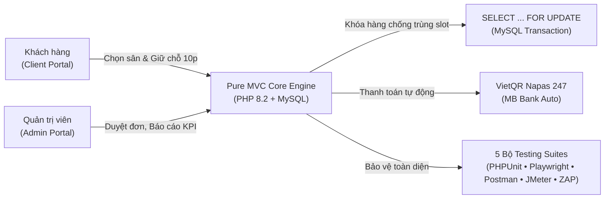

  # 👋 Xin chào, tôi là Hoàng Văn Huy! (vanhuy15)
  ### 🚀 Backend & Fullstack Developer | Software QA & Architecture Enthusiast
  
  

    
    
    
    
  

  

    Đam mê xây dựng các hệ thống web tối ưu hiệu năng cao, kiến trúc sạch (Clean MVC / Domain-Driven Design), xử lý các bài toán tranh chấp tài nguyên đồng thời (Race Condition) và áp dụng tiêu chuẩn kiểm thử phần mềm toàn diện (Unit, API, E2E, Load, Security).
  

  ---

## 🌟 DỰ ÁN NỔI BẬT (FEATURED PROJECT)

### 🏟️ [Hệ Thống Đặt Sân Bóng Đá Phủi Đà Nẵng (quanLySanBongDaPhuiDaNang)](https://github.com/vanhuy15/quanLySanBongDaPhuiDaNang)
*Nền tảng chuyển đổi số toàn diện cho chuỗi sân bóng mini phủi tại Đà Nẵng*

* **Kiến trúc Pure MVC không framework:** Tự thiết kế Router, Middleware, Base Controller và Singleton Database, phân tách 100% mã nguồn theo mô hình modular CSS/JS dễ bảo trì.
* **Xử lý Race Condition & Khóa chéo:** Áp dụng `SELECT ... FOR UPDATE` triệt tiêu 100% rủi ro đặt trùng sân khi hàng chục người cùng thao tác; xử lý logic ghép sân 7 từ các sân 5 con linh hoạt.
* **Hệ thống Điểm Uy Tín (Reputation System):** Tự động theo dõi hành vi, thưởng điểm đánh giá (+2đ), phạt hủy sát giờ (-5đ đến -15đ) và chế tài khách bùng sân (-25đ).
* **Tích hợp 5 Công cụ Kiểm thử Chuyên nghiệp:**
  * 🟢 **PHPUnit 10.5:** Kiểm thử hộp trắng 41 test cases (110 assertions) bao phủ 100% thuật toán cốt lõi.
  * 🟠 **Postman / Newman:** Kiểm thử tự động 23 endpoints API phân hệ Client & Admin.
  * 🔵 **Playwright E2E:** 10 luồng kiểm thử tự động giao diện trình duyệt thực tế Chromium.
  * 🟣 **Apache JMeter 5.6:** Giả lập tải đồng thời 50 threads tranh chấp slot và 200 CCU tải đọc.
  * 🔴 **OWASP ZAP & Custom Auditor:** Kiểm thử an ninh mạng tự động 7/7 chốt chặn OWASP Top 10.

👉 **Khám phá mã nguồn & Kịch bản Test:** [github.com/vanhuy15/quanLySanBongDaPhuiDaNang](https://github.com/vanhuy15/quanLySanBongDaPhuiDaNang)

---

## 🛠️ KỸ NĂNG & CÔNG NGHỆ (TECH STACK)

| Lĩnh vực | Công nghệ / Công cụ sử dụng |
| :--- | :--- |
| **Backend & Core** |     |
| **Frontend & UI** |     |
| **Testing & QA** |      |
| **DevOps & Tools** |      |

---

## 📊 THỐNG KÊ HOẠT ĐỘNG GITHUB (GITHUB STATS)

  
  

  

---

## 📫 KẾT NỐI VỚI TÔI (CONNECT WITH ME)

  
  

  ⭐️ Đừng ngần ngại ghé thăm và để lại một ngôi sao (Star) nếu bạn thấy các dự án của tôi hữu ích!

